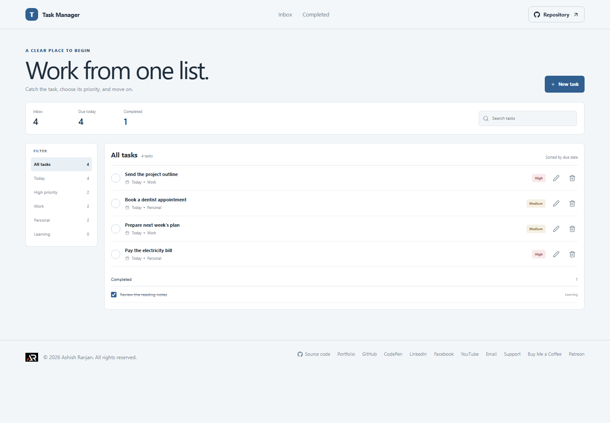

# Task Manager

Task Manager keeps a searchable task inbox with due dates, priorities, and categories.

## Interface

The page includes task totals, a search field, category filters, an editable task form, open tasks sorted by due date, and a completed list.

## Features and use

Add or edit a task title, date, priority, and category. Complete a task to move it to the completed section. Search task details or filter the open list by today, priority, or category. Delete a task after confirming.

## Data and limits

Tasks are saved in localStorage in this browser. There is no login, cloud sync, or reminder service. Clearing browser storage removes the task list.

## Run locally

Use Node.js and npm, then run these commands from the project folder:

```sh
npm install
npm run dev
```

The app is built with React and Vite. Check the source and production build with:

```sh
npm run lint
npm run build
```

## Deployment

The public app is published with GitHub Pages at [https://a2rp.github.io/task-manager/](https://a2rp.github.io/task-manager/). To build and publish the current version, run:

```sh
npm run deploy
```

## Future improvements

Ideas that are not implemented yet:

- Recurring tasks, notifications, and JSON import and export.

## Links

- Portfolio: [https://www.ashishranjan.net](https://www.ashishranjan.net)
- GitHub: [https://github.com/a2rp](https://github.com/a2rp)
- CodePen: [https://codepen.io/ash1198](https://codepen.io/ash1198)
- LinkedIn: [https://www.linkedin.com/in/aashishranjan](https://www.linkedin.com/in/aashishranjan)
- Facebook: [https://www.facebook.com/theash.ashish/](https://www.facebook.com/theash.ashish/)
- YouTube: [https://www.youtube.com/@ashishranjan-ashz?sub_confirmation=1](https://www.youtube.com/@ashishranjan-ashz?sub_confirmation=1)
- Email: [mailto:ash.ranjan09@gmail.com](mailto:ash.ranjan09@gmail.com)

## Support

- Support: [https://a2rp-donation-page.netlify.app/](https://a2rp-donation-page.netlify.app/)
- Buy Me a Coffee: [https://buymeacoffee.com/ashishranjan](https://buymeacoffee.com/ashishranjan)
- Patreon: [https://www.patreon.com/ashishranjan](https://www.patreon.com/ashishranjan)